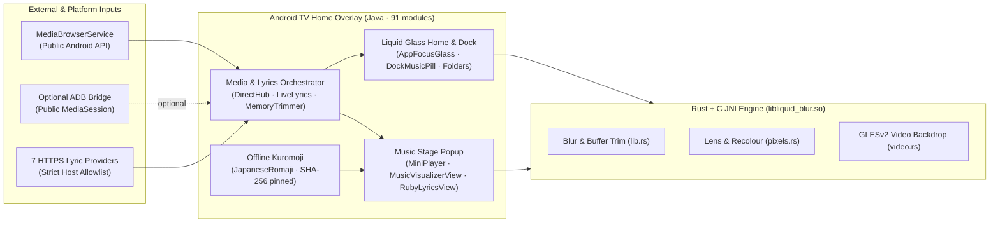

<div align="center">

# Liquid Launcher

**A frameless Liquid Glass UI, native Rust/JNI graphics engine, and 60fps live-lyrics music hub for Android TV.**

[](CHANGELOG.md)
[](#prerequisites)
[-f97316?style=flat-square&logo=rust&logoColor=white)](#architecture)
[](#native-rust--jni-pipeline)
[](LICENSE)
[](SECURITY.md)

**English** · [Tiếng Việt](README_VI.md)

[Features](#key-features) · [Architecture](#architecture) · [Performance](#performance--memory-engineering) · [Quick Start](#quick-start) · [Testing](#on-device-verification) · [Security](#security--privacy-by-design)

</div>

---

## Overview

**Liquid Launcher** is an Android TV launcher overlay crafted around **frameless translucent glass**, **D-pad-first ergonomics**, and **fluid 60fps motion**. Built as a hybrid **Java + zero-dependency Rust/JNI** overlay (91 Java modules, 4 native Rust/C modules, an optional ADB media bridge, and 27 automated on-device ART verification suites), it turns an Android TV home screen into a cohesive living-room media experience—without invasive permissions, background bloat, or closed black-box dependencies.

> **Copyright & Scope Notice:** This repository contains **100% original overlay source code** (`src/`, `native/`, `bridge/`, `stubs/`, `validation/`, and build tooling). Decompiled third-party base APK assets (`work/`), prebuilt `.apk`/`.jar` binaries, signing keystores, and local environment files are intentionally excluded. See [SECURITY.md](SECURITY.md) and [Quick Start](#quick-start) for build prerequisites.

---

## Key Features

### 1. Liquid Glass UI & Native Rust/JNI Graphics
- **Frameless Translucent Surfaces:** Unified glass materials (`GlassPolicy`, `AppFocusGlass`, `DockGlass`) with depth-aware focus motion (`HomeDepthMotion`, `DepthMotionMath`) and custom D-pad navigation across the dock, folders, settings, and control panel.
- **Zero-Dependency Rust/JNI Engine (`native/`):**
  - High-speed native blur with explicit scratch-buffer trimming (`lib.rs`, `RustBlur`).
  - Optical glass lens sampling & color recoloring (`pixels.rs`, `RustPixels`).
  - Native GLESv2 video wallpaper frame rendering (`video.rs`, `RustVideo`).
  - Strict `-Wall -Wextra -Werror` C JNI shim (`pixels_jni.c`), built for `armeabi-v7a` and `arm64-v8a` with **16 KB ELF page alignment** (`-Wl,-z,max-page-size=16384`) and audited dynamic library allowlists.
- **Live Wallpaper & Theme Engine:** Gallery, video wallpaper previews, smooth dock-to-wallpaper transitions, and automatic palette extraction (`WallpaperTheme`, `WallpaperRenderer`, `WallpaperVideo`).

### 2. Zero-Rebind Music Hub & 60fps Visualizer
- **Seamless Dock ↔ Popup Handoff (`SpotifyMetadata.DirectHub`):** Ref-counted shared `MochyMediaBrowser` and `GenericMediaBrowser` connections with a `750 ms` grace window eliminate redundant `MediaBrowserService` reconnects when opening or closing the full-screen music stage.
- **Optional Public MediaSession Bridge (`bridge/`):** A lightweight user-started ADB `app_process` helper reads public `MediaSession` metadata for Android TV music apps that do not expose `MediaBrowserService`—never touching private app storage, cookies, or credentials.
- **60fps Zero-Permission Visualizer (`MusicVisualizerView`):**
  - **Dock (`MODE_DOCK`):** 4 translucent backlit glass capsules animated in lockstep with VSync.
  - **Music Stage (`MODE_STAGE`):** Dual-layer silk aura ribbon + 28 symmetric floating glass capsules tinted dynamically to the current album art.
  - Requires **zero `RECORD_AUDIO` permission** and automatically pauses when off-screen or playback stops.

### 3. 7-Source Parallel Lyrics, Karaoke & Japanese Ruby
- **Parallel Multi-Provider Search (`LiveLyrics`, `AggregateLyrics`, `ProviderLyrics`, `ExtraLyricSources`):** Queries up to 7 public lyric providers concurrently (Better Lyrics / Apple Music TTML, LyricsPlus, LRCLIB, KuGou, NetEase, QQ Music, Paxsenix) and returns the highest-quality match fast.
- **4-Tier Matching & Quality Scoring (`LyricMatch`, `Lyrics`):**
  - Handles Japanese corner-quote titles (`「...」`, `『...』`), `Artist - Title` swaps, and MV/channel suffixes (`Official Music Video`, `Topic`, etc.).
  - Multi-factor candidate ranking with TV-size truncation rejection (`isTruncatedForDuration`) and two-tier duration tolerance (`±10 s` conditional MV fallback).
- **Honest Karaoke & Offline Japanese Furigana / Romaji (`RubyLyricsView`, `JapaneseRomaji`):**
  - Highlights word-by-word or syllable-by-syllable karaoke **only when real per-word/segment timestamps exist**—never faking timing on plain text.
  - Offline Japanese morphological analysis via SHA-256-pinned **Kuromoji IPADIC** for crisp Furigana/Romaji annotations directly above kanji lines, plus per-track manual offset (`LyricOffsetStore`) and source selection (`LyricChoiceStore`).

---

## Architecture



---

## Performance & Memory Engineering

Android TV devices often operate under strict RAM budgets (1.5–2 GB). Every hot path in Liquid Launcher is engineered for low allocations and fast recovery under memory pressure:

| Area | Implementation | Benefit |
| :--- | :--- | :--- |
| **Connection Handoff** | `SpotifyMetadata.DirectHub` ref-count + `750 ms` grace timer | Zero `MediaBrowser` rebind jitter between Dock and Popup |
| **60fps Lyrics Canvas** | Cached `FontChoice.faceEpoch()`, `Cell.blank`, memoized `LineBlock` in `RubyLyricsView` | Zero per-frame object allocations during smooth karaoke scrolling |
| **Worker Lifecycle** | `ThreadPoolExecutor` with `allowCoreThreadTimeOut(true)` across 4 async workers | Idle threads expire automatically when the TV sits on Home or another app |
| **Unified RAM Trim** | `MemoryTrimmer` hooks `WallpaperTheme`, `LiveLyrics`, `SpotifyMetadata`, `WallpaperThumbLoader`, `RustBlur`, and lazy `MusicBackdropView` buffers | Immediate cache release on `onTrimMemory` / backgrounding |
| **Instant Popup Lyrics** | 2-second debounced single-track prefetch in `DockMusicPill` (transient RAM only) | Near-`0 ms` lyrics display on popup open with zero disk writes or bulk scraping |

---

## Security & Privacy by Design

Security rules are enforced in code, build scripts, and tests—see [SECURITY.md](SECURITY.md) for full details:

- **Zero Credentials in Source:** No keystores, passwords, tokens, cookies, API keys, or device IPs exist in this repository. Signing secrets are passed strictly via `apksigner` `env:` variables (`KEYSTORE_PASS`, `KEY_PASS`), never as CLI `pass:` arguments.
- **HTTPS Allowlist & Hardened XML Parsing:** Lyric HTTP clients enforce HTTPS and an explicit domain allowlist (`LiveLyrics.allowedHost`). TTML/QRC XML parsers block `DOCTYPE`, external entities (XXE), and oversized responses.
- **Supply-Chain Integrity:** Maven dependencies (`kuromoji-core`, `kuromoji-ipadic`, `snakeyaml`) are verified against pinned SHA-256 digests in [`libs/checksums.json`](libs/checksums.json) by both `scripts/fetch-libs.ps1` and `package-reading.py`.
- **No Private App Scraping:** Media metadata is read solely through Android's public `MediaBrowserService` or the optional user-started `MediaSession` bridge.

---

## Repository Structure

```text
liquid-launcher/
├── src/                  # 91 Java overlay classes (Glass UI, Media, 7-source Lyrics, Visualizer, Folders)
├── native/               # Zero-dependency Rust + C JNI library (blur, lens/recolour, GLESv2 video)
├── bridge/               # Optional ADB app_process helper for public MediaSession metadata
├── stubs/ & stubs-extra/ # Compile-time API stubs for the host launcher layer
├── libs/checksums.json   # Pinned SHA-256 hashes for Kuromoji & SnakeYAML jars
├── scripts/              # env.ps1 (.env loader) & fetch-libs.ps1 (verified Maven downloader)
├── validation/           # 35 ART test sources (27 default suites + live network/media checks)
├── package-reading.py    # SHA-256 verifier & Kuromoji dictionary resource packager
├── build.ps1             # Parameterized build script (-CompileOnly or full signed APK)
├── .env.example          # Local configuration template (copy to gitignored .env)
├── CHANGELOG.md          # Release history
├── CONTRIBUTING.md       # Contribution workflow & standards
└── SECURITY.md           # Security & privacy policy
```

---

## Quick Start

### Prerequisites

| Tool | Required Version / Notes |
| :--- | :--- |
| **JDK** | JDK 17 (`javac`, `jar`, `java`; compiles to `-source 8 -target 8`) |
| **Android SDK** | `platform-tools`, `build-tools 35.0.0`, `platforms/android-35` |
| **Android NDK + Rust** | NDK `27.2.12479018` + Rust `1.85.1` (`armv7-linux-androideabi`, `aarch64-linux-android`) |
| **Python** | Python 3.8+ |
| **Optional (Full APK Packaging)** | `apktool.jar`, a locally supplied decompiled base APK directory (`work/`), and a signing `.keystore` stored **outside** the repository |

### 1. Fetch & Verify Pinned Libraries

```powershell
.\scripts\fetch-libs.ps1
```

Downloads `kuromoji-core-0.9.0.jar`, `kuromoji-ipadic-0.9.0.jar`, and `snakeyaml-2.7.jar` from Maven Central and verifies each against [`libs/checksums.json`](libs/checksums.json).

### 2. Configure Local Environment

```powershell
Copy-Item .env.example .env
# Edit .env with your local JDK, Android SDK, and (for full APK builds) apktool/keystore paths.
```

> Never commit `.env` or your `.keystore` file. Both are blocked by [`.gitignore`](.gitignore).

### 3. Build

```powershell
# Compile overlay only (Java + Rust/JNI + D8 classes.dex — no base work/ or keystore required):
.\build.ps1 -CompileOnly

# Skip Rust rebuild if native .so files are unchanged:
.\build.ps1 -CompileOnly -SkipNative

# Full APK packaging & signing (requires BASE_WORK_DIR, APKTOOL_JAR, KEYSTORE_* in .env):
.\build.ps1 -OutApk dist\LiquidLauncher.apk
```

### 4. Optional ADB Media Bridge

```powershell
.\bridge\build.ps1
.\bridge\start-bridge.ps1 -Tv 192.168.1.100:5555

# Stop cleanly when no longer needed (playback is unaffected):
.\bridge\stop-bridge.ps1 -Tv 192.168.1.100:5555
```

---

## On-Device Verification

Liquid Launcher ships with **27 default ART verification suites** (plus optional `-Live` media and `-LiveLyrics` network checks) that execute directly on an Android TV device via `app_process` and automatically clean up temporary files in `/data/local/tmp` when finished:

```powershell
# Build overlay + bridge first
.\build.ps1 -CompileOnly -SkipNative
.\bridge\build.ps1

# Run all 27 offline ART suites (metadata, visualizer, lyric matching, ruby layout, memory/perf, security)
.\validation\run-checks.ps1 -Tv 192.168.1.100:5555

# Include live network parallel lyrics check
.\validation\run-checks.ps1 -Tv 192.168.1.100:5555 -LiveLyrics
```

---

## Contributing & License

Contributions, bug reports, and performance improvements are welcome! Please read [CONTRIBUTING.md](CONTRIBUTING.md) and [SECURITY.md](SECURITY.md) before opening a Pull Request.

Distributed under the **MIT License** — see [LICENSE](LICENSE) for details.
