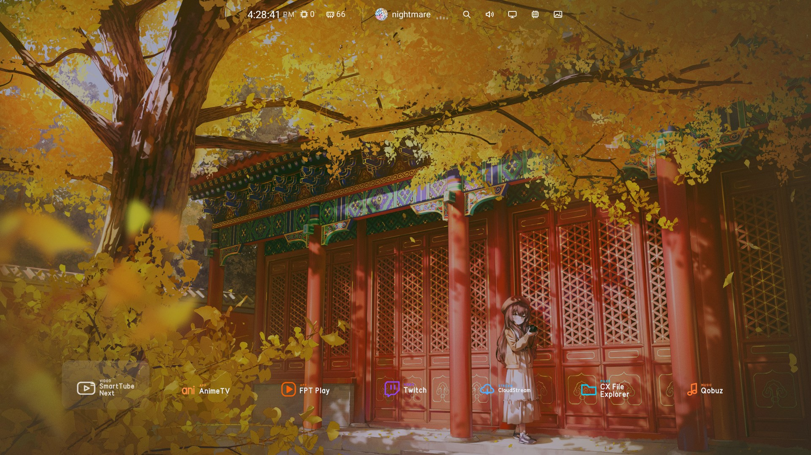
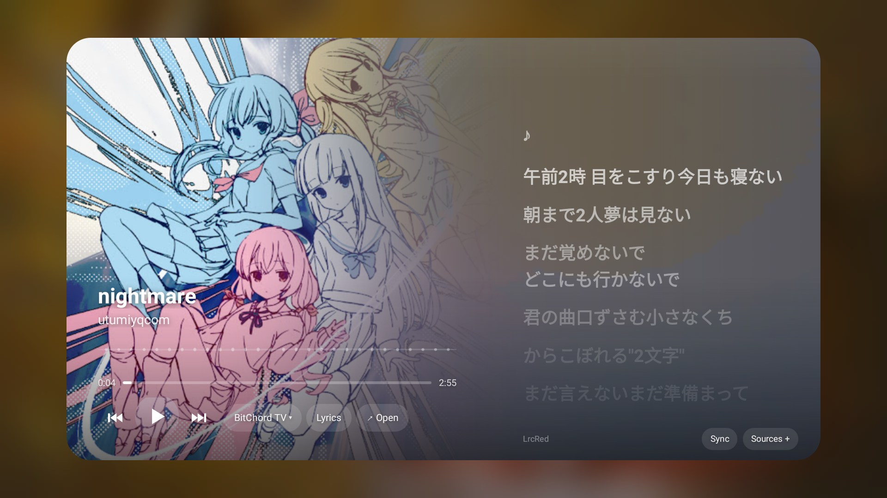
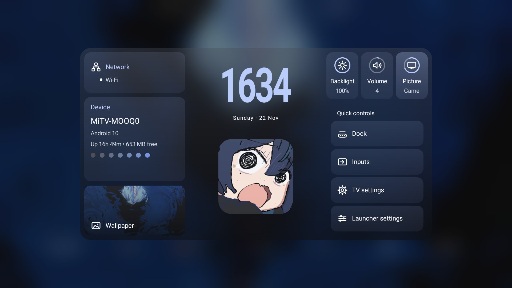
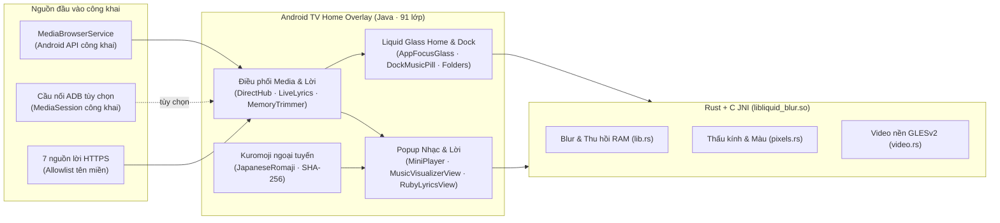

<div align="center">

# Liquid Launcher

**Giao diện kính mờ Liquid Glass không viền, bộ xử lý đồ họa Rust/JNI và trình phát nhạc kèm lời 60fps dành cho Android TV.**

[](https://github.com/Zewieee/liquid-launcher/actions/workflows/ci.yml)
[](https://github.com/Zewieee/liquid-launcher/actions/workflows/provider-health.yml)
[](CHANGELOG.md)
[](#yêu-cầu-môi-trường)
[-f97316?style=flat-square&logo=rust&logoColor=white)](#kiến-trúc-hệ-thống)
[](#tính-năng-nổi-bật)
[](LICENSE)
[](SECURITY.md)

[English](README.md) · **Tiếng Việt**

[Hình ảnh thực tế](#hình-ảnh-giao-diện-thực-tế) · [Tính năng](#tính-năng-nổi-bật) · [Kiến trúc](#kiến-trúc-hệ-thống) · [Hiệu năng](#tối-ưu-hiệu-năng--ram) · [Cài đặt nhanh](#hướng-dẫn-biên-dịch-nhanh) · [Kiểm thử & Bảo trì](#kiểm-thử-art-trên-thiết-bị) · [Bảo mật](#bảo-mật--quyền-riêng-tư)

</div>

---

## Tổng quan

**Liquid Launcher** là lớp mở rộng giao diện cho launcher Android TV, tập trung vào ngôn ngữ thiết kế **kính mờ trong suốt không viền**, **thao tác D-pad trực quan bằng remote** và **chuyển động mượt 60fps**. Dự án kết hợp **91 lớp Java**, **4 mô-đun Rust/C JNI không phụ thuộc crate ngoài**, một **cầu nối media ADB tùy chọn** và **27 bộ kiểm thử ART tự động** chạy trực tiếp trên thiết bị.

> **Lưu ý bản quyền & phạm vi:** Kho mã nguồn này chỉ chứa **100% mã nguồn gốc tự phát triển** (`src/`, `native/`, `bridge/`, `stubs/`, `validation/` và bộ script build). Thư mục giải mã APK gốc của bên thứ ba (`work/`), file `.apk`/`.jar` biên dịch sẵn, keystore ký số và tệp `.env` cục bộ được loại trừ hoàn toàn. Xem thêm [SECURITY.md](SECURITY.md).

---

## Hình ảnh giao diện thực tế

<div align="center">

### Màn hình chính Liquid Glass & Thanh Dock trên cùng (Visualizer 4 cột `MODE_DOCK`)


### Sân khấu Popup Nhạc 60fps & Lời bài hát đồng bộ (Visualizer 28 cột `MODE_STAGE`)


### Trung tâm điều khiển Liquid Glass (Làm mờ nền trực tiếp bằng Rust/JNI)


</div>

---

## Tính năng nổi bật

### 1. Giao diện Liquid Glass & Đồ họa Rust/JNI
- **Kính mờ trong suốt đồng nhất:** Hệ thống vật liệu kính (`GlassPolicy`, `AppFocusGlass`, `DockGlass`), hiệu ứng chiều sâu khi di chuyển tiêu điểm (`HomeDepthMotion`, `DepthMotionMath`), quản lý thư mục ứng dụng và bảng điều khiển tối ưu cho remote TV.
- **Thư viện gốc Rust/JNI (`native/`):**
  - Làm mờ nền tốc độ cao kèm thu hồi bộ đệm tạm (`lib.rs`, `RustBlur`).
  - Hiệu ứng thấu kính quang học & phối màu (`pixels.rs`, `RustPixels`).
  - Vẽ nền video GLESv2 trực tiếp ở tầng native (`video.rs`, `RustVideo`).
  - Lớp cầu nối C JNI biên dịch nghiêm ngặt `-Wall -Wextra -Werror` (`pixels_jni.c`), hỗ trợ song song `armeabi-v7a` và `arm64-v8a`, căn chỉnh trang **16 KB** (`-Wl,-z,max-page-size=16384`).
- **Hình nền động & Trích xuất màu chủ đạo:** Thư viện hình nền ảnh/video, xem trước trực tiếp và tự đồng bộ tông màu theo hình nền (`WallpaperTheme`, `WallpaperRenderer`, `WallpaperVideo`).

### 2. Trình phát nhạc không giật nối & Visualizer 60fps
- **Chuyển cảnh Dock ↔ Popup tức thì (`SpotifyMetadata.DirectHub`):** Dùng chung kết nối `MochyMediaBrowser` và `GenericMediaBrowser` theo cơ chế đếm tham chiếu (ref-count) kèm thời gian chờ `750 ms`, triệt tiêu hiện tượng ngắt/nối lại `MediaBrowserService` khi mở popup nhạc.
- **Cầu nối MediaSession tùy chọn qua ADB (`bridge/`):** Tiến trình `app_process` gọn nhẹ đọc metadata `MediaSession` công khai cho các ứng dụng nhạc Android TV không mở `MediaBrowserService`, tuyệt đối không đọc dữ liệu riêng tư hay cookie của ứng dụng khác.
- **MusicVisualizerView 60fps không cần quyền mic:**
  - **Chế độ Dock (`MODE_DOCK`):** 4 viên kính có đèn nền đồng bộ VSync.
  - **Chế độ Sân khấu (`MODE_STAGE`):** Dải lụa phát sáng 2 lớp kết hợp 28 cột kính đối xứng đổi màu theo ảnh bìa bài hát.
  - Không yêu cầu quyền `RECORD_AUDIO`, tự tạm dừng khi rời màn hình hoặc dừng nhạc.

### 3. Lời bài hát song song 7 nguồn, Karaoke & Furigana/Romaji
- **Truy vấn song song 7 nguồn công khai (`LiveLyrics`, `AggregateLyrics`, `ProviderLyrics`, `ExtraLyricSources`):** Better Lyrics (Apple Music TTML), LyricsPlus, LRCLIB, KuGou, NetEase, QQ Music và Paxsenix.
- **Chuẩn hóa & chấm điểm 4 tầng (`LyricMatch`, `Lyrics`):**
  - Tự nhận diện tiêu đề tiếng Nhật có dấu ngoặc góc (`「...」`, `『...』`), đảo `Artist - Title` và lọc hậu tố MV/kênh tải lên.
  - Chấm điểm đa yếu tố, tự loại bản cắt TV-size (`isTruncatedForDuration`) và áp dụng dung sai thời lượng 2 tầng (`±10 giây` có điều kiện cho bản MV).
- **Karaoke trung thực & phiên âm Nhật ngoại tuyến (`RubyLyricsView`, `JapaneseRomaji`):**
  - Chỉ tô chữ theo nhịp karaoke khi nguồn có mốc thời gian từ/đoạn thật.
  - Tích hợp bộ tách từ **Kuromoji IPADIC** (xác minh SHA-256) tạo Furigana/Romaji ngay trên thiết bị, kèm lưu độ trễ lời theo từng bài (`LyricOffsetStore`) và đổi nguồn thủ công (`LyricChoiceStore`).

---

## Kiến trúc hệ thống



---

## Tối ưu hiệu năng & RAM

- **Zero-Rebind MediaBrowser:** `SpotifyMetadata.DirectHub` giữ kết nối chung trong `750 ms` giữa Dock và Popup.
- **Zero-Allocation 60fps:** `RubyLyricsView` tái sử dụng `FontChoice.faceEpoch()`, `Cell.blank` và cache `LineBlock`, tránh cấp phát rác khi cuộn karaoke.
- **Tự giải phóng luồng & bộ nhớ:** 4 luồng nền dùng `ThreadPoolExecutor` có `allowCoreThreadTimeOut(true)`; `MemoryTrimmer` đồng loạt thu gọn cache của `WallpaperTheme`, `LiveLyrics`, `SpotifyMetadata`, `WallpaperThumbLoader`, `RustBlur` và buffer vẽ lười của `MusicBackdropView`.
- **Tải trước tức thì đúng 1 bài:** `DockMusicPill` tải trước bài đang phát vào RAM tạm sau `2 giây` debounce (không ghi đĩa, không tải hàng loạt), giúp mở Popup thấy lời gần như `0 ms`.

---

## Bảo mật & Quyền riêng tư

Xem chi tiết tại [SECURITY.md](SECURITY.md):

- Không lưu keystore, mật khẩu, token, cookie, API key hay địa chỉ thiết bị trong mã nguồn; `build.ps1` truyền mật khẩu ký số qua biến môi trường `apksigner env:`.
- Chỉ dùng HTTPS tới danh sách tên miền cho phép (`LiveLyrics.allowedHost`); bộ đọc TTML/QRC chặn `DOCTYPE`, thực thể ngoài (XXE) và giới hạn dung lượng gói tin.
- Kiểm tra mã băm SHA-256 cố định trong [`libs/checksums.json`](libs/checksums.json) trước mọi lần đóng gói.

---

## Yêu cầu môi trường

- **JDK 17** (`javac`, `jar`, `java`)
- **Android SDK** (`platform-tools`, `build-tools 35.0.0`, `platforms/android-35`)
- **Android NDK `27.2.12479018`** + **Rust `1.85.1`** (`armv7-linux-androideabi`, `aarch64-linux-android`)
- **Python 3.8+**
- *(Tùy chọn, chỉ khi đóng gói APK hoàn chỉnh)* `apktool.jar`, thư mục `work/` từ APK gốc của riêng bạn và file `.keystore` lưu **ngoài** repo.

---

## Hướng dẫn biên dịch nhanh

```powershell
# 1. Tải & xác minh SHA-256 các thư viện Kuromoji + SnakeYAML
.\scripts\fetch-libs.ps1

# 2. Tạo tệp cấu hình cục bộ (.env đã nằm trong .gitignore)
Copy-Item .env.example .env

# 3. Biên dịch mã nguồn overlay (Java + Rust/JNI + D8 classes.dex, không cần work/ hay keystore)
.\build.ps1 -CompileOnly

# Hoặc đóng gói & ký APK đầy đủ:
.\build.ps1 -OutApk dist\LiquidLauncher.apk
```

### Cầu nối ADB tùy chọn

```powershell
.\bridge\build.ps1
.\bridge\start-bridge.ps1 -Tv 192.168.1.100:5555
.\bridge\stop-bridge.ps1 -Tv 192.168.1.100:5555
```

---

## Kiểm thử ART trên thiết bị

Chạy toàn bộ **27 bộ kiểm thử ART** trực tiếp trên Android TV (tự dọn tệp tạm trong `/data/local/tmp` sau khi hoàn tất):

```powershell
.\validation\run-checks.ps1 -Tv 192.168.1.100:5555
# Hoặc kiểm tra thêm nguồn lời trực tuyến:
.\validation\run-checks.ps1 -Tv 192.168.1.100:5555 -LiveLyrics
```

### Bảo trì tự động & GitHub Actions CI

- **CI Build & Quét bảo mật ([`.github/workflows/ci.yml`](.github/workflows/ci.yml)):** Tự động chạy trên mỗi lần push hoặc tạo Pull Request để quét rò rỉ bí mật/tệp nhị phân (`scripts/check-maintenance.py --offline`), kiểm tra SHA-256 thư viện Maven, biên dịch toàn bộ 91 lớp Java + cầu nối ADB + 35 lớp kiểm thử + đóng gói D8 DEX với Android API 35, đồng thời chạy `cargo check` cho thư viện Rust `1.85.1`.
- **Giám sát định kỳ 7 nguồn lời bài hát ([`.github/workflows/provider-health.yml`](.github/workflows/provider-health.yml)):** Tự động kiểm tra hàng tuần (hoặc bấm chạy thủ công 1 chạm trên tab Actions) tình trạng hoạt động và độ trễ của 7 API lời bài hát HTTPS để phát hiện sớm nếu có nguồn bên thứ ba đổi endpoint. Bạn cũng có thể chạy kiểm tra ngay trên máy bất cứ lúc nào:
  ```powershell
  python scripts/check-maintenance.py
  ```

---

## Đóng góp & Giấy phép

Mọi đóng góp, báo lỗi và đề xuất tối ưu đều được hoan nghênh! Vui lòng đọc [CONTRIBUTING.md](CONTRIBUTING.md) trước khi mở Pull Request.

Phát hành theo giấy phép **MIT License** — xem chi tiết trong [LICENSE](LICENSE).
